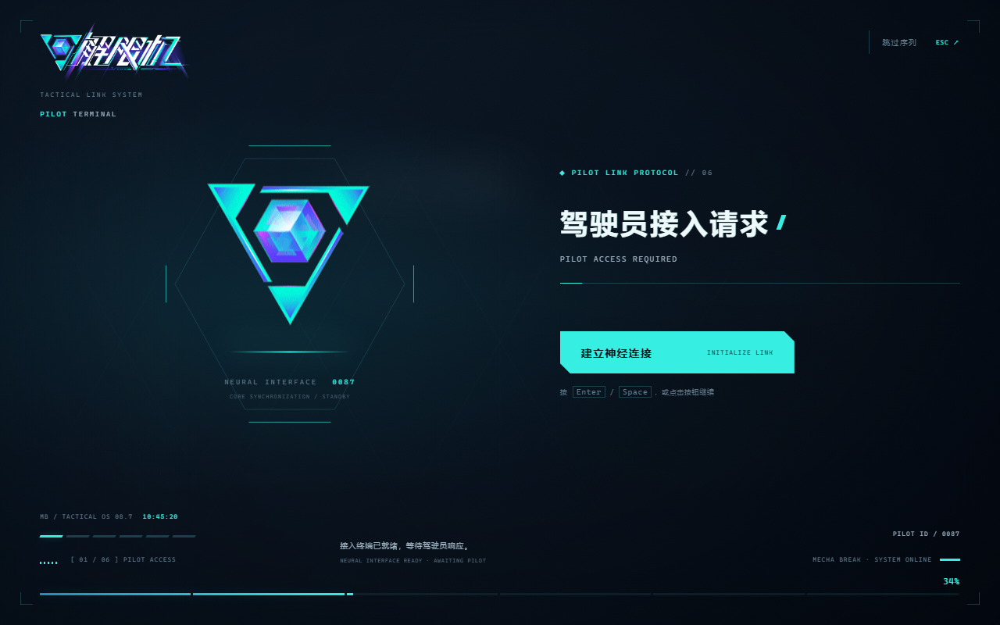

# 解限机风格 DSH 启动动画

青紫晶体、透明中文 Logo、驾驶员接入终端，以及《解限机》原始按键音效与中文系统播报。

由 **dy拾鹭 / [16shilu](https://github.com/16shilu)** 改编维护，基于沈宏宏的 [dsh-startup-screen](https://github.com/6shenhonghong9/dsh-startup-screen) 1.3.0。保留上游提交历史、MIT 许可证与署名；插件包名和加载 ID 继续使用 `dsh-startup-screen`。



## 下载

到 **[Releases 下载最新版本](https://github.com/16shilu/dsh-startup-screen-mecha/releases/latest)**。

| 文件 | 用途 |
| --- | --- |
| `dsh-startup-screen-mecha-1.4.0-mecha.3.zip` | 转发给朋友的分享包：插件 TGZ、PDF 与 Word 安装说明 |
| `dsh-startup-screen-1.4.0-mecha.3.tgz` | 通过 DSH 命令安装的插件包 |
| `install-guide.zh-CN.pdf` / `.docx` | 单独下载安装说明，含“dy拾鹭”水印 |

分享包不含离线预览或“先读我.txt”。图标、动画、音效和播报均随插件提供，运行时不依赖游戏安装目录或外部素材服务。

## Windows 官方桌面版安装

1. 打开一次 DSH 并进入工作区。在“应用”菜单的“管理 dsh 命令…”中安装桌面版命令，再新开终端运行 `dsh --version`。
2. 从系统托盘**完全退出 DSH**；仅关闭窗口可能只是隐藏。
3. 在已解压分享包、包含 TGZ 的文件夹中打开 PowerShell，执行：

```powershell
dsh plugin --profile desktop add ".\dsh-startup-screen-1.4.0-mecha.3.tgz"
```

4. 重新打开 DSH，在“设置 → 启动动画”中启用并保存，可点“立即预览”核对。

新版官方桌面版需使用其内置运行时注册的 `dsh` 命令，npm 全局版不能代替。[官方说明](https://github.com/deepseek-ai/deepseek-harness/blob/master/apps/desktop/README.zh.md#终端命令)

完整步骤与排错：[PDF](docs/install-guide.zh-CN.pdf) · [Word](docs/install-guide.zh-CN.docx) · [安装说明](INSTALL.md)。如果已经安装上游同名插件，本改编版会更新该 profile 内的 `dsh-startup-screen`。

已能正常运行 `dsh web` 的网页用户可将命令中的 `desktop` 改为 `web`，安装后重启 `dsh web`。

## 启动流程与素材

1. 驾驶员接入请求：确认建立连接。
2. 驾驶员身份认证：确认驾驶员档案。
3. 方晶粒子填充。
4. 驾驶员同步率稳定。
5. 意识投影系统启动完成。
6. 欢迎回来，揭幕进入 DSH。

前三句系统状态与结尾欢迎语使用游戏原始中文录音。启动录音只在句间停顿处分为三个连续 PCM 片段，拼接后与完整录音逐采样相同；没有变调、变速或 TTS 模仿。前两次人工确认只播放游戏原始按键音效。

主图标使用[解限机官方 GIPHY 发布的透明加载动画](https://giphy.com/stickers/MechaBREAK-eic-mecha-break-mechabreak-jlUkYjMqoT9iK87w2B)：51 帧、约 6 秒循环。该动图不是此次从游戏安装包解出的文件；查找范围见[动画来源记录](docs/MECHA-ANIMATION-SEARCH.md)。透明图标和中文 Logo 保留提供的 PNG 原字节。

支持深空与极地诊断两套主题、窄屏布局、按钮 / Enter / 空格确认、Esc 跳过、重播及独立语音 / 音效音量。首次点击或按键后开启声音。系统启用“减少动态效果”或动图加载失败时显示静态图标。

配置保存在 `$DSH_HOME/dsh-startup-mecha.json`，默认 `~/.dsh/dsh-startup-mecha.json`。设置中的身份名称、编号、主题、速度、声音及文案均可调整。

## 开发与验证

运行时为原生 JavaScript / CSS，无第三方 npm 运行依赖。Node.js 要求不低于 20。

```bash
npm test
python scripts/build-release.py
```

浏览器回归脚本为 `test/browser-mecha.mjs`；用 `PLAYWRIGHT_CORE_PATH` 指向已安装的 `playwright-core` 后运行它。它使用 `test/fixtures` 内的工程测试页面，生成文件位于已忽略的 `.test-output`，不会装入插件。

已通过 Host、运行时、设置页和桌面自举的自动检查，以及真实无头 Chromium 的布局、动图帧变化、透明背景、音频播放、跳过与重播检查。尚未在其他电脑的真实 DSH 桌面环境完成实装验证；不同 DSH 版本和第三方桌面壳需按实际情况确认。

## 来源与许可

- 上游：[6shenhonghong9/dsh-startup-screen](https://github.com/6shenhonghong9/dsh-startup-screen)，原作者沈宏宏，基于提交 `7f3d2837c1aaef8293abc69093b0a35c80d0f0e8` 改编。
- 保留[原作者 MIT 许可证](LICENSE)。游戏图标、动画、音效和语音的权利归各自权利人，不适用代码许可证。
- [素材来源与 SHA-256](docs/MECHA-ASSET-SOURCES.json) · [音频事件映射](AUDIO-FIELDS.md) · [上游原始说明](docs/UPSTREAM-README.md)。

本项目为 DSH 的个人主题改编，与游戏官方无关联。
